# Pocket AI

Личное приложение для iPhone: чат с нейросетями в двух режимах.

- **Офлайн** — модель работает прямо на телефоне, без интернета. Разговоры никуда не уходят.
- **Онлайн** — большие модели, картинки, видео и музыка на вашем собственном сервере с видеокартой (RunPod).
  Сервер сам включается, когда он нужен, и сам выключается, когда им не пользуются.

Приложение собирается автоматически на GitHub и ставится на iPhone с Windows через Sideloadly —
без Mac и без App Store.

## Как выглядит

Снимки сделаны автоматически в симуляторе iPhone (iOS 26) с моделью Qwen3 1.7B; ответы на них настоящие.

<p>
  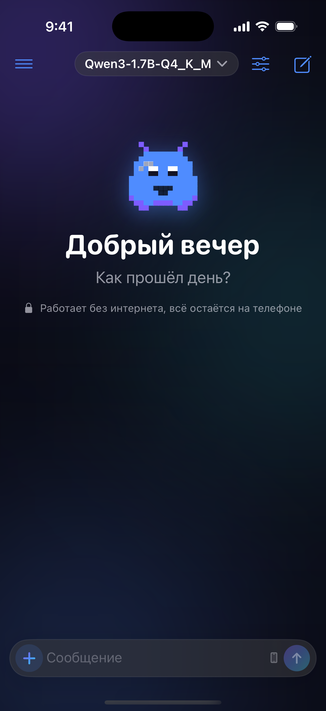
  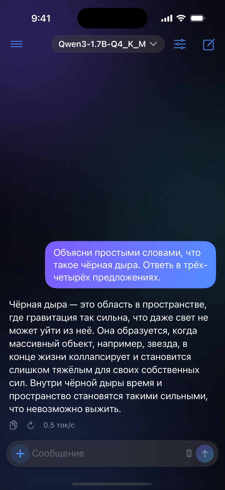
  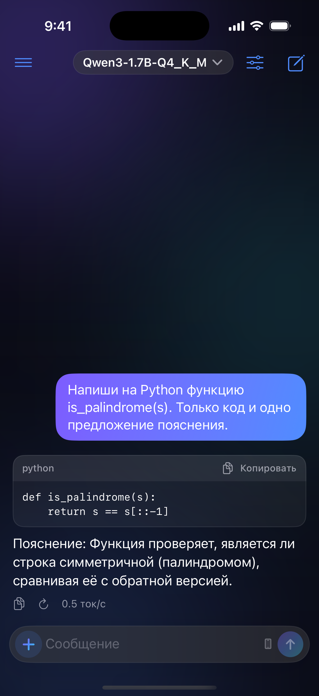
  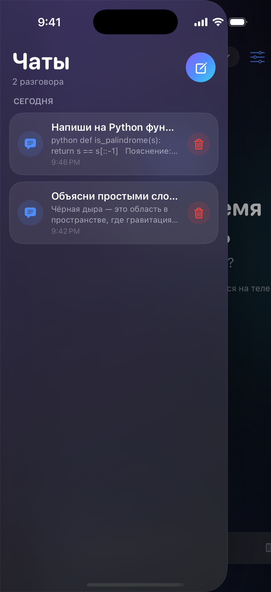
</p>
<p>
  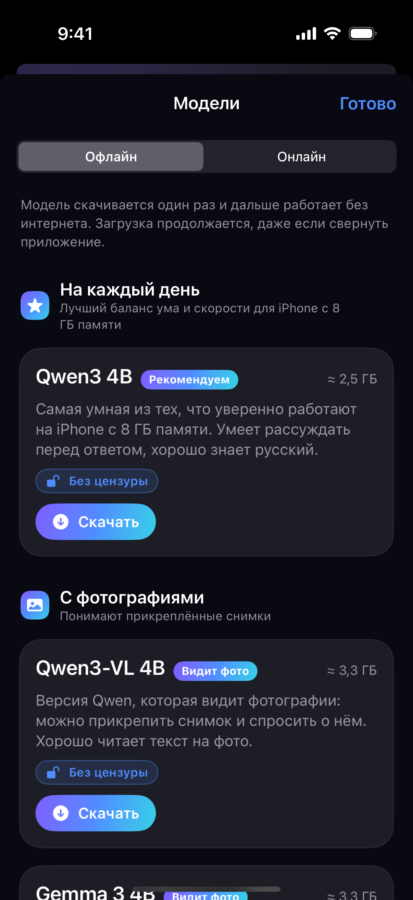
  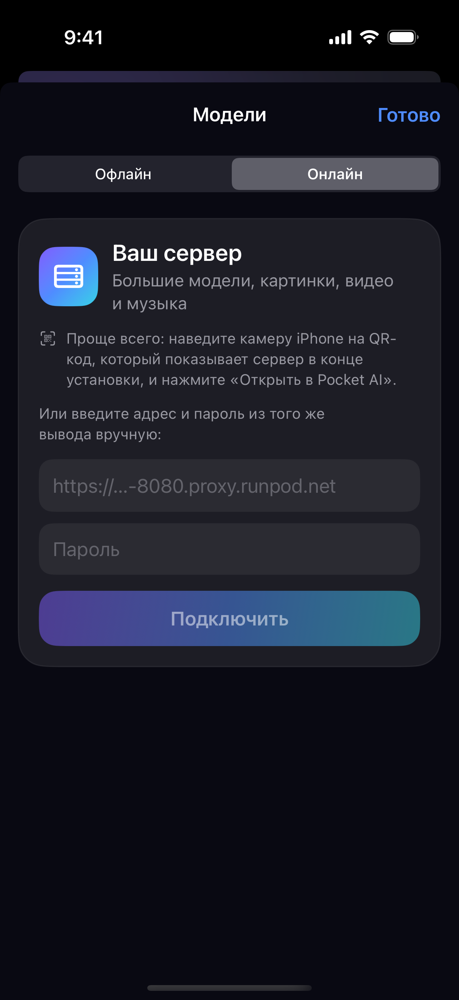
  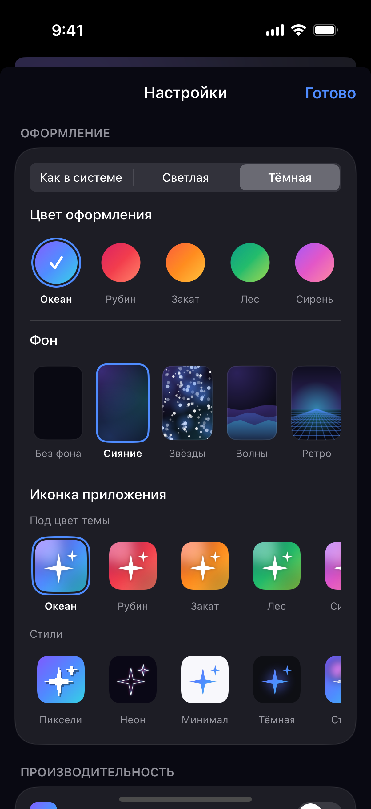
  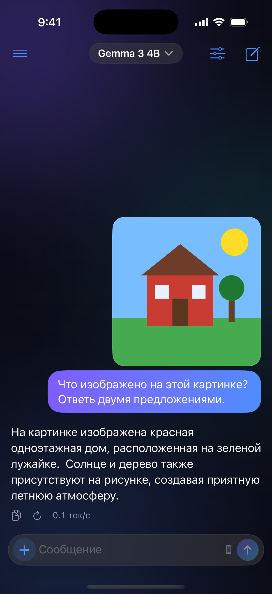
</p>
<p>
  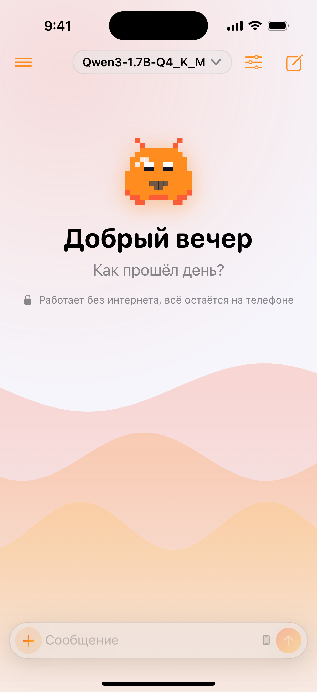
  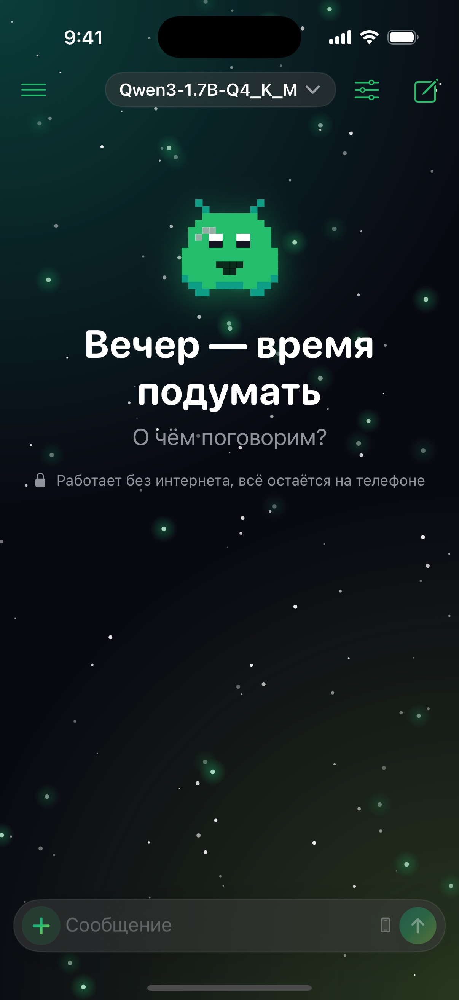
  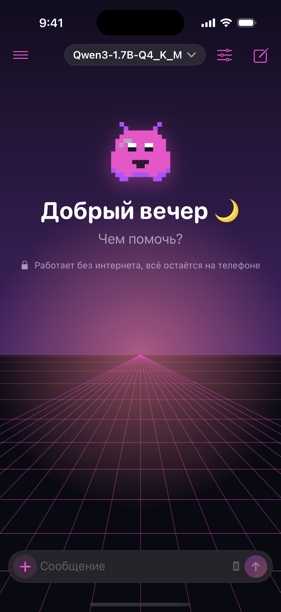
</p>

## Возможности

### Чат
- Ответ появляется по мере написания; поддерживаются заголовки, списки, цитаты и блоки кода с кнопкой «Копировать».
- **«+» в поле ввода**: фото из галереи, с камеры или из «Файлов» (для моделей, которые видят фото),
  а также документы — текст, код и PDF. Содержимое файла уходит модели, в сообщении видна только плашка с именем.
- **Режим размышлений**: модель сначала обдумывает задачу; ход мыслей можно развернуть под ответом.
- Приветствие по времени суток и пиксельный монстрик в цветах темы.
- Чаты в боковой панели: сгруппированы по дням, у каждого превью и кнопка удаления.
- Клавиатура сворачивается нажатием на пустое место.

### Офлайн-модели (на телефоне)

| Модель | Размер | Особенности |
| --- | --- | --- |
| Qwen3 4B | ≈ 2,5 ГБ | Основная: самая умная для iPhone с 8 ГБ памяти, умеет рассуждать |
| Qwen3-VL 4B | ≈ 3,3 ГБ | Видит фото, хорошо читает текст на снимках |
| Gemma 3 4B | ≈ 3,3 ГБ | Видит фото, хороший русский язык |
| Qwen3 1.7B | ≈ 1,8 ГБ | Лёгкая и быстрая |

- У каждой есть версия **без цензуры** — она скачивается отдельно, кнопкой на карточке модели
  или переключателем «Без цензуры» в настройках.
- Можно добавить любую модель в формате GGUF — по прямой ссылке или файлом из «Файлов».
- Модели работают через [llama.cpp](https://github.com/ggml-org/llama.cpp) на графическом чипе iPhone.

### Онлайн-режим (ваш сервер)
- **Текст и код**: Qwen3.6 27B, Gemma, gpt-oss 20B, DeepSeek R1 32B, Qwen3-Coder 30B, маленькая быстрая Qwen3 4B
  и Gemma 3 27B без цензуры. На карточках — плашки с сильными сторонами и минусами каждой модели.
- **Студия**: картинки (FLUX.1, SDXL), видео (Wan 2.2) и музыка с вокалом (ACE-Step).
  Описание можно писать по-русски — сервер переводит его на английский, сохраняя заказанный стиль,
  и показывает, какой запрос получила модель. Готовые работы можно смотреть, слушать, сохранять и отправлять.
- **Подключение по QR-коду**: сервер показывает QR, его сканирует камера iPhone — и приложение подключено.
- **Питание**: сервер включается сам, когда вы пишете онлайн-модели или создаёте что-то в Студии,
  и выключается сам после 10 минут простоя (время настраивается). Если видеокарту на машине RunPod заняли,
  приложение само создаёт новый сервер на том же сетевом диске.

### Уведомления и работа в фоне
- Уведомления о скачанных моделях, готовых ответах, картинках, видео и музыке.
- Когда приложение закрыто, уведомления с сервера приходят через бесплатное приложение **ntfy**;
  в разделе «Онлайн» есть кнопка «Проверить уведомление».
- Если свернуть приложение посреди ответа, он встаёт на паузу и дописывается, когда вы вернётесь.
  Экспериментальный режим «Дописывать в фоне» (iOS 26) продолжает ответ на процессоре с прогрессом на экране блокировки.

### Оформление
- Светлая, тёмная или как в системе; шесть цветовых тем: Океан, Рубин, Закат, Лес, Сирень, Графит.
- Фон чата: Сияние, Звёзды, Волны, Ретро, Градиент, Боке или «Без фона» — цвет следует за темой.
- Иконка приложения: в цвет любой темы или в одном из стилей — Пиксели, Неон, Минимал, Тёмная, Стекло, Контур.
- Liquid glass на iOS 26, анимации по всему приложению.
- Раздел «Производительность»: **Лёгкий режим** (без стекла, размытия и движения фона),
  **Без анимаций**, **Замирать во время ответа**.

## Установка на iPhone с Windows

1. Скачайте приложение: [PocketAI.ipa](https://github.com/tastyLLLLLLLLLL/ai-ios-app/releases/latest/download/PocketAI.ipa).
2. Установите [iTunes](https://www.apple.com/itunes/) (с сайта Apple, не из Microsoft Store) и [Sideloadly](https://sideloadly.io/).
3. Подключите iPhone кабелем, разблокируйте и нажмите «Доверять». Перетащите `PocketAI.ipa` в Sideloadly,
   введите Apple ID и нажмите **Start**.
4. На iPhone: **Настройки → Основные → VPN и управление устройством** → ваш Apple ID → **Доверять**.
5. На iPhone: **Настройки → Конфиденциальность и безопасность → Режим разработчика** → включить
   (пункт появляется после первой попытки открыть приложение).
6. Откройте Pocket AI → «Выбрать и скачать модель».

С бесплатным Apple ID приложение нужно переустанавливать через Sideloadly раз в 7 дней.
Обновления ставятся так же, поверх старой версии: чаты и модели сохраняются.

**Если Sideloadly пишет «Login failed»** — подождите час (Apple временно блокирует частые попытки входа),
обновите Sideloadly, проверьте VPN и антивирус: ошибка `SSLError … gsa.apple.com` означает, что соединение с Apple режется по дороге.

## Свой сервер (онлайн-режим)

Нужен аккаунт [RunPod](https://www.runpod.io) с балансом от $10.

1. **Ключ для входа.** В PowerShell: `ssh-keygen -t ed25519`, затем добавьте содержимое
   `id_ed25519.pub` в RunPod → Settings → SSH Public Keys.
2. **Сетевой диск.** RunPod → Storage → Network Volumes → New: 200 ГБ, дата-центр, где есть видеокарты
   с 32–48 ГБ памяти (A40, RTX A6000, L40S, RTX PRO 4500).
3. **Сервер.** Pods → Deploy, фильтр Network volume → ваш диск, шаблон PyTorch,
   Set overrides: Container disk 50 ГБ, HTTP-порт `8080`, TCP-порт `22`. Deploy.
4. **Установка** (30–60 минут) — в консоли сервера:
   ```
   apt-get update -qq && apt-get install -y -qq tmux && tmux new -s setup
   curl -fsSL https://raw.githubusercontent.com/tastyLLLLLLLLLL/ai-ios-app/main/server/setup.sh | bash
   ```
   В конце появятся QR-код, адрес, пароль и тема для ntfy. Команда безопасна для повторного запуска:
   она обновляет сервер и докачивает только недостающее.
5. **Приложение.** Отсканируйте QR камерой iPhone → «Открыть в Pocket AI». В «Модели → Онлайн → Питание сервера»
   вставьте ключ RunPod (Settings → API Keys, права Read/Write) — тогда приложение сможет включать сервер само.
6. **Автозапуск.** RunPod → сервер → Edit Pod → Start command: `bash /workspace/ai-server/autostart.sh`.
7. **Уведомления.** Поставьте на iPhone приложение ntfy и подпишитесь на тему из шага 4.

Если сервер включали вручную без автозапуска, запустить всё можно командой `bash /workspace/ai-server/start.sh`
(она же заново показывает QR-код).

**Расходы:** сетевой диск 200 ГБ — около $14–28 в месяц (постоянно); сервер — около $0,4–1 за час, только пока он включён.

Пароль сервера и ключ RunPod хранятся только у вас: на сервере и в защищённом хранилище iPhone.
Не публикуйте их и не вставляйте в код — репозиторий открытый.

## Как устроен проект

| Путь | Что там |
| --- | --- |
| `App/Engine/` | Запуск моделей через llama.cpp, форматы диалога разных моделей |
| `App/Models/` | Логика: чаты, офлайн-модели и их загрузка, сервер, уведомления, работа в фоне |
| `App/Views/` | Экраны на SwiftUI: чат, модели, онлайн-раздел, Студия, настройки, темы и фоны, монстрик |
| `App/Assets.xcassets/` | Иконки приложения (цвета тем и стили логотипа) |
| `server/setup.sh` | Установка сервера: Ollama с текстовыми моделями, ComfyUI с моделями для картинок, видео и музыки |
| `server/gateway.py` | Шлюз для приложения: пароль, чат, задачи Студии, перевод описаний, автовыключение, ntfy |
| `server/start.sh`, `server/autostart.sh` | Запуск сервера вручную и при включении |
| `project.yml` | Описание проекта для XcodeGen |
| `.github/workflows/build.yml` | Сборка `PocketAI.ipa` на каждое изменение и публикация в Releases |
| `.github/workflows/screenshots.yml`, `scripts/screenshots.sh` | Скриншоты из симулятора с настоящей моделью |
