# Pocket AI

<p align="center">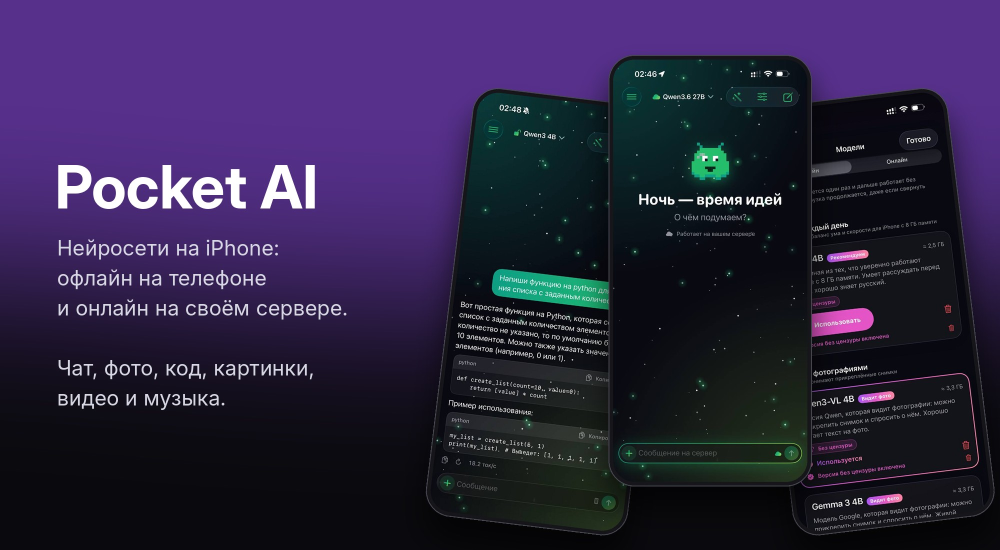</p>

Личное приложение для iPhone: чат с нейросетями в двух режимах.

- **Офлайн** — модель работает прямо на телефоне, без интернета. Разговоры никуда не уходят.
- **Онлайн** — большие модели, картинки, видео и музыка на вашем собственном сервере с видеокартой (RunPod).
  Сервер сам включается, когда он нужен, и сам выключается, когда им не пользуются.

Приложение собирается автоматически на GitHub и ставится на iPhone с Windows через Sideloadly —
без Mac и без App Store.

## Как выглядит

Снимки с настоящего iPhone.

<p align="center">
  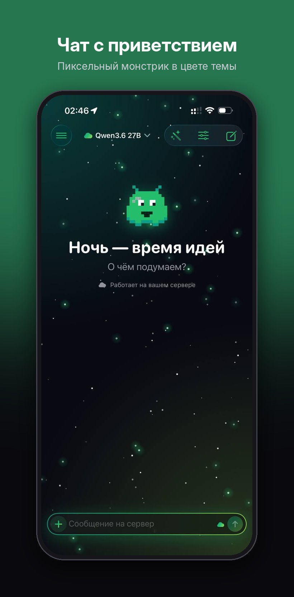
  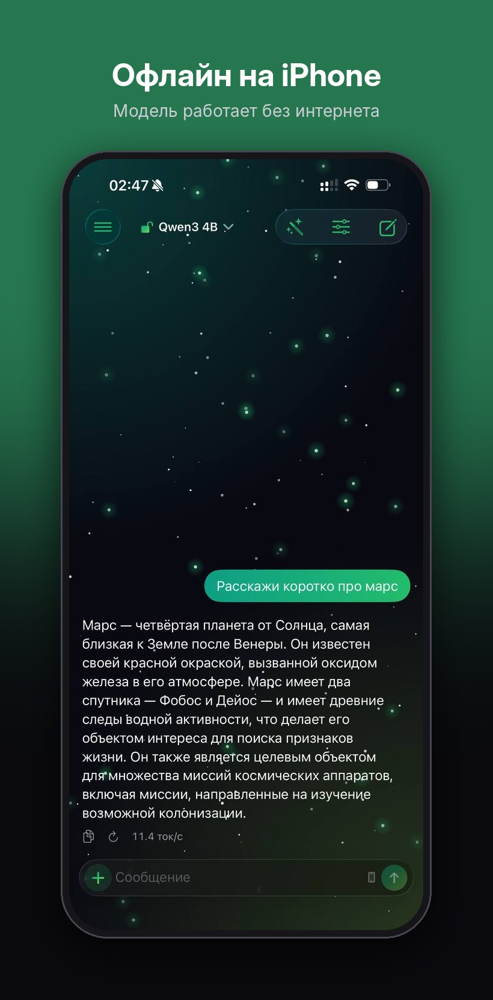
  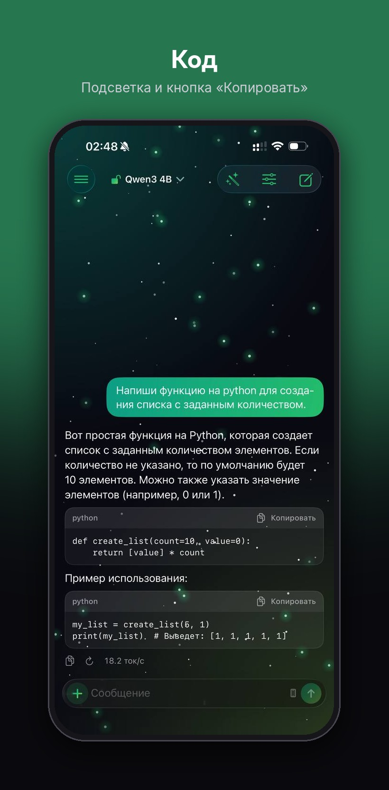
</p>
<p align="center">
  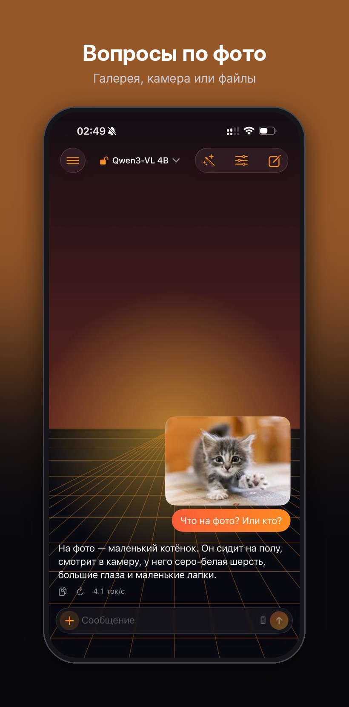
  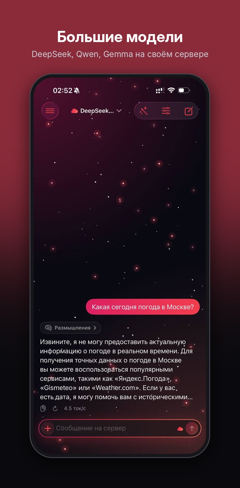
  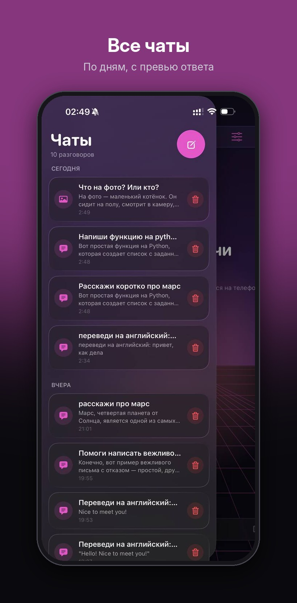
</p>
<p align="center">
  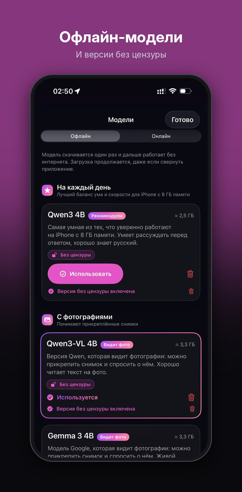
  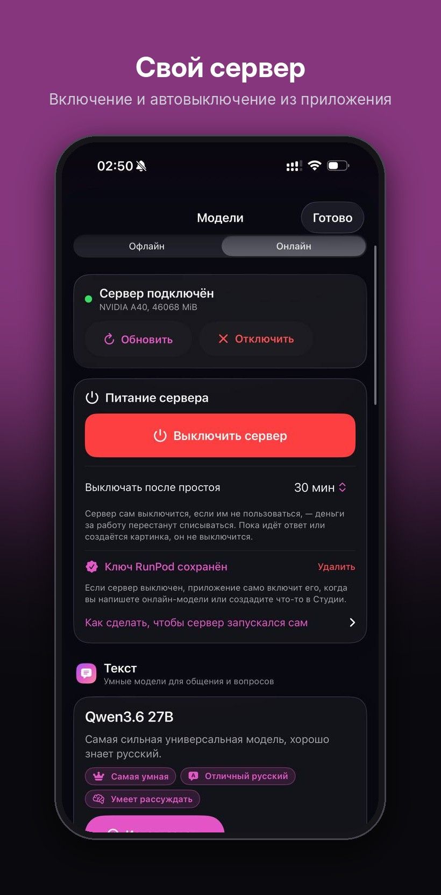
  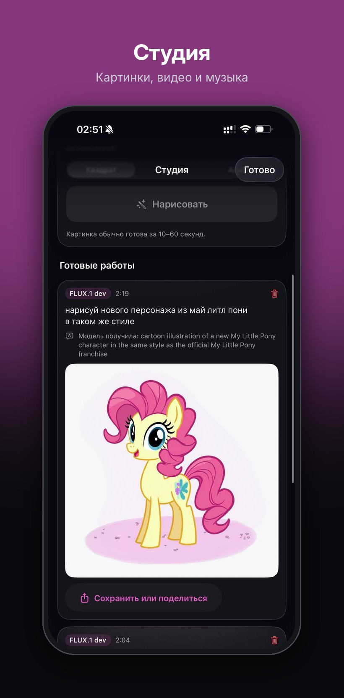
</p>
<p align="center">
  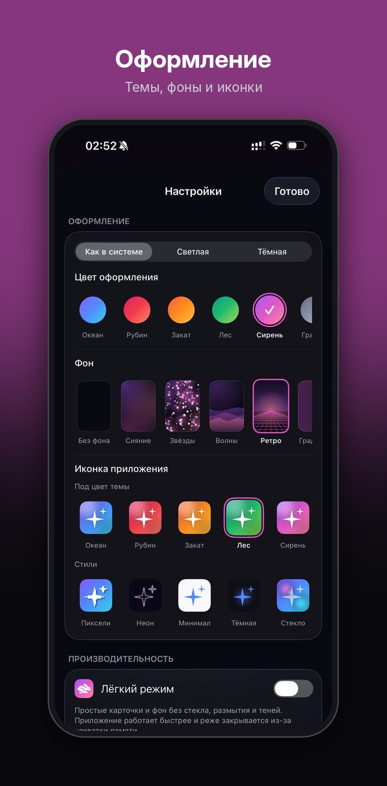
  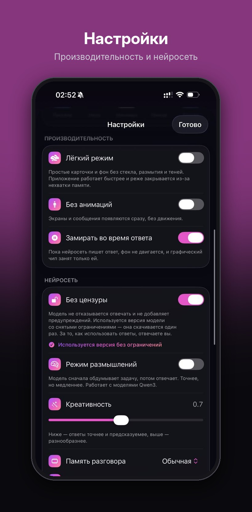
  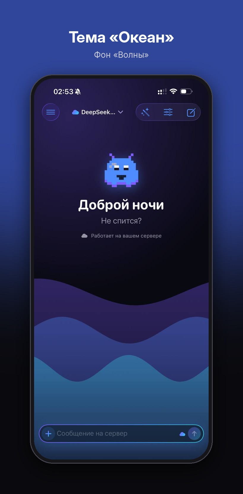
</p>
<p align="center">
  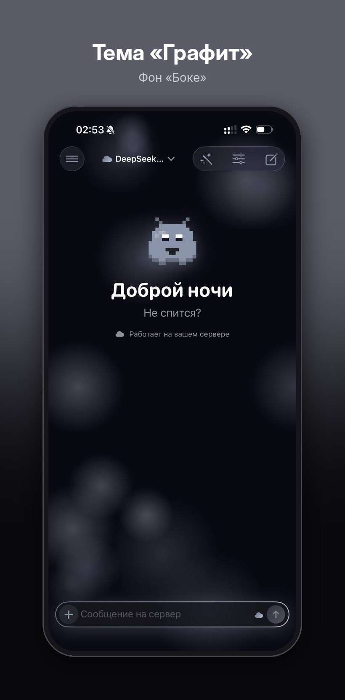
</p>

## Возможности

### Чат
- Ответ появляется по мере написания; поддерживаются заголовки, списки, цитаты и блоки кода с кнопкой «Копировать».
- **«+» в поле ввода**: фото из галереи, с камеры или из «Файлов» (для моделей, которые видят фото),
  а также документы — текст, код и PDF. Содержимое файла уходит модели, в сообщении видна только плашка с именем.
- **Режим размышлений**: модель сначала обдумывает задачу; ход мыслей можно развернуть под ответом.
- Приветствие по времени суток и пиксельный монстрик в цветах темы.
- Чаты в боковой панели: сгруппированы по дням, у каждого превью и кнопка удаления.
- Клавиатура сворачивается нажатием на пустое место.

### Офлайн-модели (на телефоне)

| Модель | Размер | Особенности |
| --- | --- | --- |
| Qwen3 4B | ≈ 2,5 ГБ | Основная: самая умная для iPhone с 8 ГБ памяти, умеет рассуждать |
| Qwen3-VL 4B | ≈ 3,3 ГБ | Видит фото, хорошо читает текст на снимках |
| Gemma 3 4B | ≈ 3,3 ГБ | Видит фото, хороший русский язык |
| Qwen3 1.7B | ≈ 1,8 ГБ | Лёгкая и быстрая |

- У каждой есть версия **без цензуры** — она скачивается отдельно, кнопкой на карточке модели
  или переключателем «Без цензуры» в настройках.
- Можно добавить любую модель в формате GGUF — по прямой ссылке или файлом из «Файлов».
- Модели работают через [llama.cpp](https://github.com/ggml-org/llama.cpp) на графическом чипе iPhone.

### Онлайн-режим (ваш сервер)
- **Текст и код**: Qwen3.6 27B, Gemma, gpt-oss 20B, DeepSeek R1 32B, Qwen3-Coder 30B, маленькая быстрая Qwen3 4B
  и Gemma 3 27B без цензуры. На карточках — плашки с сильными сторонами и минусами каждой модели.
- **Студия**: картинки (FLUX.1, SDXL), видео (Wan 2.2) и музыка с вокалом (ACE-Step).
  Описание можно писать по-русски — сервер переводит его на английский, сохраняя заказанный стиль,
  и показывает, какой запрос получила модель. Готовые работы можно смотреть, слушать, сохранять и отправлять.
- **Подключение по QR-коду**: сервер показывает QR, его сканирует камера iPhone — и приложение подключено.
- **Питание**: сервер включается сам, когда вы пишете онлайн-модели или создаёте что-то в Студии,
  и выключается сам после 10 минут простоя (время настраивается). Если видеокарту на машине RunPod заняли,
  приложение само создаёт новый сервер на том же сетевом диске.

### Уведомления и работа в фоне
- Уведомления о скачанных моделях, готовых ответах, картинках, видео и музыке.
- Когда приложение закрыто, уведомления с сервера приходят через бесплатное приложение **ntfy**;
  в разделе «Онлайн» есть кнопка «Проверить уведомление».
- Если свернуть приложение посреди ответа, он встаёт на паузу и дописывается, когда вы вернётесь.
  Экспериментальный режим «Дописывать в фоне» (iOS 26) продолжает ответ на процессоре с прогрессом на экране блокировки.

### Оформление
- Светлая, тёмная или как в системе; шесть цветовых тем: Океан, Рубин, Закат, Лес, Сирень, Графит.
- Фон чата: Сияние, Звёзды, Волны, Ретро, Градиент, Боке или «Без фона» — цвет следует за темой.
- Иконка приложения: в цвет любой темы или в одном из стилей — Пиксели, Неон, Минимал, Тёмная, Стекло, Контур.
- Liquid glass на iOS 26, анимации по всему приложению.
- Раздел «Производительность»: **Лёгкий режим** (без стекла, размытия и движения фона),
  **Без анимаций**, **Замирать во время ответа**.

## Установка на iPhone с Windows

1. Скачайте приложение: [PocketAI.ipa](https://github.com/tastyLLLLLLLLLL/ai-ios-app/releases/latest/download/PocketAI.ipa).
2. Установите [iTunes](https://www.apple.com/itunes/) (с сайта Apple, не из Microsoft Store) и [Sideloadly](https://sideloadly.io/).
3. Подключите iPhone кабелем, разблокируйте и нажмите «Доверять». Перетащите `PocketAI.ipa` в Sideloadly,
   введите Apple ID и нажмите **Start**.
4. На iPhone: **Настройки → Основные → VPN и управление устройством** → ваш Apple ID → **Доверять**.
5. На iPhone: **Настройки → Конфиденциальность и безопасность → Режим разработчика** → включить
   (пункт появляется после первой попытки открыть приложение).
6. Откройте Pocket AI → «Выбрать и скачать модель».

С бесплатным Apple ID приложение нужно переустанавливать через Sideloadly раз в 7 дней.
Обновления ставятся так же, поверх старой версии: чаты и модели сохраняются.

**Если Sideloadly пишет «Login failed»** — подождите час (Apple временно блокирует частые попытки входа),
обновите Sideloadly, проверьте VPN и антивирус: ошибка `SSLError … gsa.apple.com` означает, что соединение с Apple режется по дороге.

## Свой сервер (онлайн-режим)

Онлайн-режим работает на вашем собственном арендованном компьютере с мощной видеокартой.
Ниже — как собрать такой сервер на [RunPod](https://www.runpod.io) с нуля. Займёт около часа, большая часть —
ожидание, пока скачиваются модели.

**Что понадобится:** компьютер с Windows (подойдёт и Mac/Linux), банковская карта, которую принимает RunPod
(Visa/Mastercard, выпущенная за пределами России, или криптовалюта), и $10–25 на балансе для начала.

### Как это устроено

- **Сетевой диск** (Network Volume) — постоянное хранилище на 200 ГБ. На нём лежат все модели и настройки.
  Он платный всё время, но зато ничего не теряется и не скачивается заново.
- **Под** (Pod) — сам компьютер с видеокартой. Платите только за часы, когда он включён.
  Приложение включает его, когда вы пишете онлайн-модели, а сервер сам выключается после 10 минут простоя.
- Если видеокарту на той машине, где был под, займёт кто-то другой, приложение само создаст новый под
  на том же сетевом диске — модели никуда не денутся.

### Шаг 1. Аккаунт и баланс

1. Зарегистрируйтесь на [runpod.io](https://www.runpod.io).
2. **Billing** → пополните баланс ($10 хватит на первые часы и установку).

### Шаг 2. SSH-ключ (чтобы подключаться к серверу)

1. Откройте PowerShell и выполните `ssh-keygen -t ed25519`. На все вопросы жмите Enter.
2. Выведите открытый ключ: `type $env:USERPROFILE\.ssh\id_ed25519.pub` — это одна строка, начинается с `ssh-ed25519`.
3. RunPod → **Settings → SSH Public Keys** → вставьте эту строку → Save.

Файл **без** `.pub` — секретный, никому его не отправляйте.

### Шаг 3. Сетевой диск

1. RunPod → **Storage → Network Volumes → New Network Volume**.
2. **Data center** — выберите тот, где в списке есть свободные видеокарты с 32–48 ГБ памяти:
   A40, RTX A6000, L40S, RTX PRO 4500 (при выборе дата-центра RunPod показывает, какие карты там доступны).
   От этого выбора зависит, на каких картах сервер сможет работать.
3. **Size** — 200 ГБ, имя любое (например, `ai_models`). Create.

### Шаг 4. Под с видеокартой

1. RunPod → **Pods → Deploy**.
2. Вверху в фильтре **Network Volume** выберите ваш диск — список покажет только подходящие карты.
3. Выберите видеокарту (A40 или RTX A6000 — хороший баланс цены и памяти) и тип **On-Demand**
   (Spot дешевле, но его могут выключить в любой момент).
4. **Template** — `RunPod Pytorch` (любой свежей версии).
5. **Edit Template / Set overrides**:
   - Container Disk — **50 ГБ**;
   - Expose HTTP Ports — **8080**;
   - Expose TCP Ports — **22**.
6. **Deploy On-Demand** и подождите, пока статус станет **Running**.

### Шаг 5. Установка моделей

1. В карточке пода нажмите **Connect** → **Web Terminal** (или подключитесь по SSH командой оттуда же).
2. Вставьте две команды:
   ```
   apt-get update -qq && apt-get install -y -qq tmux && tmux new -s setup
   curl -fsSL https://raw.githubusercontent.com/tastyLLLLLLLLLL/ai-ios-app/main/server/setup.sh | bash
   ```
   `tmux` нужен, чтобы установка не прервалась, если закрыть окно. Вернуться к ней — `tmux attach -t setup`.
3. Установка идёт 30–60 минут: ставит Ollama, ComfyUI и скачивает модели для текста, кода, картинок, видео и музыки.
4. В конце скрипт покажет **QR-код, адрес, пароль и тему для уведомлений**. Сохраните пароль у себя.

Команду можно запускать повторно — она обновит сервер и докачает только то, чего не хватает.

### Шаг 6. Подключение приложения

1. Отсканируйте QR-код камерой iPhone → «Открыть в Pocket AI». Либо в приложении:
   **Модели → Онлайн** → введите адрес и пароль вручную.
2. Чтобы приложение само включало сервер: RunPod → **Settings → API Keys → Create API Key**
   (права Read/Write), скопируйте ключ и вставьте его в **Модели → Онлайн → Питание сервера**.
   Ключ хранится только в защищённом хранилище iPhone.

### Шаг 7. Автозапуск

Чтобы после включения всё запускалось само: RunPod → ваш под → **Edit Pod** → в поле **Container Start Command**
впишите
```
bash /workspace/ai-server/autostart.sh
```
и сохраните. Без этого после каждого включения пришлось бы заходить в терминал и запускать
`bash /workspace/ai-server/start.sh` вручную (эта же команда снова показывает QR-код).

### Шаг 8. Уведомления (по желанию)

Установите на iPhone бесплатное приложение **ntfy** и подпишитесь на тему, которую показал сервер.
Проверить: **Модели → Онлайн → Проверить уведомление**.

### Сколько это стоит

| Что | Цена |
| --- | --- |
| Сетевой диск 200 ГБ | ≈ $14–28 в месяц, списывается всегда |
| Под с видеокартой (A40 / A6000 / L40S) | ≈ $0,4–1 в час, только пока включён |

Пример: час-два в день — примерно $30–50 в месяц вместе с диском.
Если сервер больше не нужен — удалите под и сетевой диск, тогда списания прекратятся полностью.

### Если что-то не так

- **«Нет свободной видеокарты» / GPU unavailable** — на машине, где был под, карты заняты.
  Приложение само пересоздаст под на том же диске (нужен ключ RunPod из шага 6). Вручную: удалите под и
  сделайте новый, как в шаге 4, с тем же сетевым диском — устанавливать заново ничего не нужно.
- **Первый ответ долгий** — модель загружается в видеокарту, это до минуты; дальше быстро.
  В приложении в это время видна плашка «Модель загружается».
- **Приложение пишет, что сервер выключен** — проверьте в RunPod, что под в статусе Running
  и что в нём указан автозапуск (шаг 7).
- **Нет уведомлений** — проверьте тему в ntfy и нажмите «Проверить уведомление».

Пароль сервера и ключ RunPod — только ваши. Не публикуйте их и не вставляйте в код: репозиторий открытый.

## Как устроен проект

| Путь | Что там |
| --- | --- |
| `App/Engine/` | Запуск моделей через llama.cpp, форматы диалога разных моделей |
| `App/Models/` | Логика: чаты, офлайн-модели и их загрузка, сервер, уведомления, работа в фоне |
| `App/Views/` | Экраны на SwiftUI: чат, модели, онлайн-раздел, Студия, настройки, темы и фоны, монстрик |
| `App/Assets.xcassets/` | Иконки приложения (цвета тем и стили логотипа) |
| `server/setup.sh` | Установка сервера: Ollama с текстовыми моделями, ComfyUI с моделями для картинок, видео и музыки |
| `server/gateway.py` | Шлюз для приложения: пароль, чат, задачи Студии, перевод описаний, автовыключение, ntfy |
| `server/start.sh`, `server/autostart.sh` | Запуск сервера вручную и при включении |
| `project.yml` | Описание проекта для XcodeGen |
| `.github/workflows/build.yml` | Сборка `PocketAI.ipa` на каждое изменение и публикация в Releases |
| `.github/workflows/screenshots.yml`, `scripts/screenshots.sh` | Скриншоты из симулятора с настоящей моделью |
